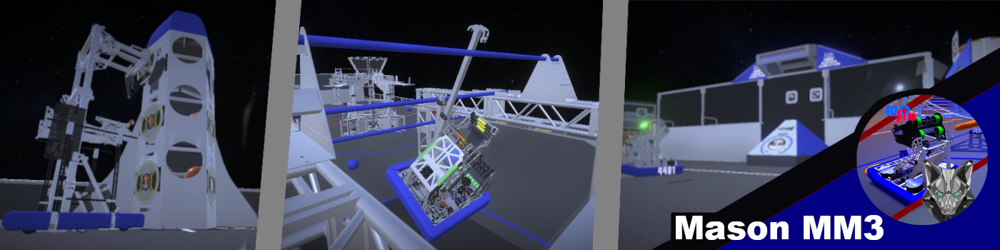

  

<h1 align="center">Mason MM3</h1>

  <b>Computer Engineering Major @ Purdue University</b> 
  Founder of <b>Cascade Studios LLP</b> & <b>Mo Sim</b>

  
  
  

## Featured Work

<table>
  <tr>
    <td width="50%" valign="top">
      <h3 align="center"><a href="https://mosimulator.com/">Mo Sim</a></h3>
      
Real-time physics and robotics simulation platform built in Unity.

      

        
        
      

    </td>
    <td width="50%" valign="top">
      <h3 align="center">Cascade Studios LLP</h3>
      
Independent studio developing real-time simulation tools and systems software.

      

        
        
        
      

    </td>
  </tr>
</table>

## Technologies

### Systems & Low-Level

### Simulation & Game Development

### Design & CAD

### Scripting & Languages

